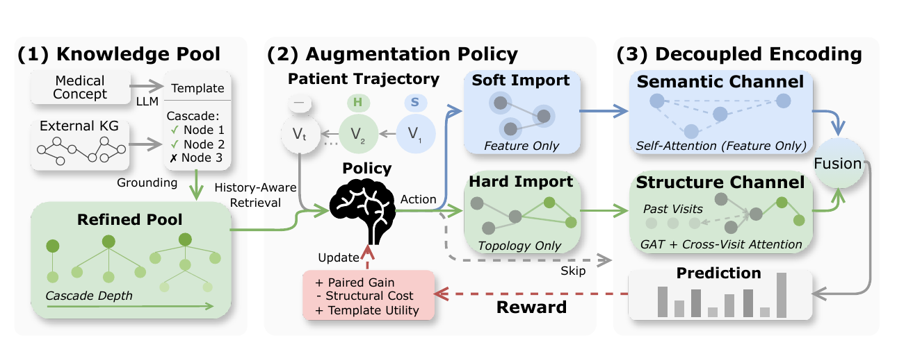

# ReTA: Import What You Need



ReTA learns when and how to augment longitudinal EHR graphs with external
knowledge. At each visit, it selects **Soft Import**, **Hard Import**, or
**Skip** using a REINFORCE policy and a decoupled semantic/structural encoder.
The implementation uses PyTorch and PyTorch Geometric.

## Install

For the original Python 3.11 environment:

```bash
git clone https://github.com/ChenC2002/ReTA.git
cd ReTA
python3.11 -m venv .venv
source .venv/bin/activate
python -m pip install -r requirements.txt -e .
```

For newer GPUs, including Blackwell, see [GPU setup](docs/setup.md).

## Check the installation

```bash
reta validate-pool-release
reta validate-template-pool --templates_jsonl examples/tiny_templates.jsonl --expected_dim 4
python -m unittest discover -s tests -p 'test*.py'
```

Tests use synthetic inputs and do not require MIMIC access.

## Train and evaluate

Prepare the data and knowledge pool using the [workflow guide](docs/workflow.md),
then set their paths in [configs/reta.yaml](configs/reta.yaml).

```bash
python -m reta.learning.warmup --config configs/reta.yaml
python -m reta.learning.rl_train --config configs/reta.yaml
python -m reta.learning.select_checkpoint --config configs/reta.yaml \
  --checkpoints checkpoints/rl_iter*.pt --out checkpoints/best.pt
python -m reta.learning.inference --checkpoint checkpoints/best.pt \
  --processed_path data/processed/processed.pt \
  --templates_jsonl data/knowledge/templates.jsonl \
  --entity_to_token_json data/resources/entity_to_token.json \
  --split_json data/processed/splits.json --split test --out results/inference.json
```

Training supports `--resume` at epoch/iteration boundaries. Checkpoint selection
uses validation patients only. See the workflow guide for input formats,
resume requirements, and multi-seed Slurm runs.

## Release scope

This repository includes source, tests, pool-building specifications, and a tiny
example. It does **not** include credentialed clinical datasets, the complete
frozen knowledge pool, or trained paper checkpoints. Files under `results/` and
`logs/` contain paper-reported references, not reproduced runs.

The executable task is next-visit diagnosis prediction. Mortality/readmission
experiments and full paper reproduction remain outside the implemented pipeline.
[Validation notes](docs/validation.md) describe the checks and their limits.
