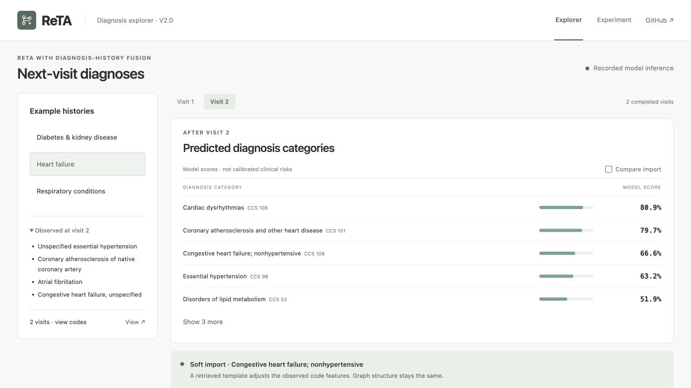
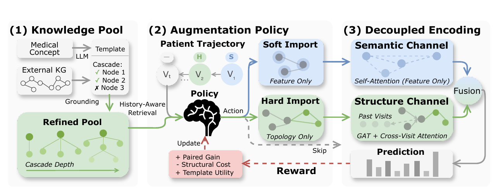

# Import What You Need: Learning When and How to Augment EHR Graphs with External Knowledge

ReTA (**Re**inforcement learning-based dynamic **T**opology **A**ugmentation)
learns whether, what, and how to import external knowledge at each visit.
It retrieves relevant templates, chooses **Soft Import**, **Hard Import**, or
**Skip**, and predicts the next visit’s diagnosis categories from the evolving
patient history.

[Live Demo](https://chenc2002.github.io/ReTA/demo/) · [Method](#method) · [Data](#data) · [Workflow](#workflow)

## Demo

[**Open the interactive demo**](https://chenc2002.github.io/ReTA/demo/)

Explore three example histories, switch visits, and compare predictions before
and after knowledge import. The online viewer replays model outputs; the local
demo also accepts edited inputs.

<a href="https://chenc2002.github.io/ReTA/demo/">
  
</a>

| Package | Size | Contents |
| --- | ---: | --- |
| [Offline viewer](https://github.com/ChenC2002/ReTA/releases/download/V2.0/reta-demo-offline.zip) | 15.6 KB | Open `index.html`; includes all three recorded examples and evaluation |
| [Complete demo model](https://github.com/ChenC2002/ReTA/releases/download/V2.0/reta-demo-model.zip) | 139.2 MB | Both prediction branches, knowledge resources, configuration, and reference predictions |
| [Core ReTA model](https://github.com/ChenC2002/ReTA/releases/download/V2.0/reta-core-model.zip) | 129.5 MB | Original graph model and import policy, with the same portable resources |
| [SHA-256 checksums](https://github.com/ChenC2002/ReTA/releases/download/V2.0/SHA256SUMS) | <1 KB | Verify the downloaded archives |

The demo combines ReTA with a linear diagnosis-history model; the core ReTA
package is also available. Both include complete checkpoints and cached concept features.
The package contains no patient records.

<details>
<summary>Run locally (Python 3.10–3.13)</summary>

```bash
git clone https://github.com/ChenC2002/ReTA.git
cd ReTA
python3 -m venv .venv
source .venv/bin/activate
python -m pip install ".[demo]"
reta demo
```

To run the model locally, download and extract the
[model package](https://github.com/ChenC2002/ReTA/releases/download/V2.0/reta-demo-model.zip), then run:

```bash
reta demo --bundle /path/to/reta-demo-model --verify
reta demo --bundle /path/to/reta-demo-model
```

Open `http://127.0.0.1:8765`. CPU inference is sufficient. `--verify` checks
the package and reproduces all three recorded examples.

</details>

<details>
<summary>MIMIC-III experiment</summary>

The demo was trained on a **7,494-patient MIMIC-III cohort**, with frozen
ClinicalBERT concept features and 196 CCS ontology templates. Held-out evaluation
covers **1,499 patients and 2,518 next-visit predictions**, across 283 labels.

The released demo uses **25% ReTA and 75% linear-history logits**, selected on
validation. Both branches are fitted on training patients. The table reports the
core algorithm and this engineering variant separately.

| Model | Macro-AUPRC | Micro-F1 | Acc@20 |
| --- | ---: | ---: | ---: |
| Diagnosis frequency | 4.32% | 33.53% | 44.56% |
| Linear history model | 21.70% | 48.88% | 63.46% |
| ReTA encoder | 18.64% | 43.04% | 58.16% |
| ReTA adaptive knowledge | 18.82% | 44.06% | 59.05% |
| ReTA + linear history | **22.32%** | **49.65%** | **64.14%** |

These are results of the released demo experiment: a patient-disjoint split,
seed 42, and validation-selected checkpoint and F1 threshold. The table evaluates held-out
patient trajectories; demo histories illustrate inference. See the
[history-head workflow](docs/workflow.md#optional-demo-history-head) to fit the optional demo variant.

</details>

## Method



### 1. Retrieve knowledge

Build visit graphs from diagnosis codes and a pool of grounded knowledge templates.
Retrieve relevant templates from the current visit and patient history.

### 2. Choose an import

A visit-level policy chooses **Soft Import** to adjust code features, **Hard Import**
to add connected knowledge nodes, or **Skip** to keep the visit unchanged.

### 3. Predict and learn

Semantic attention and graph attention encode the visit with causal history memory.
The predictor estimates next-visit diagnosis categories. Encoder warm-up is followed
by REINFORCE policy learning and supervised predictor updates.

### Code map

| Paper stage | Code | What it does |
| --- | --- | --- |
| **Visit graphs** | [`reta/data/`](reta/data) | Group admissions, map ICD to CCS, and construct visit graphs |
| **Knowledge pool** | [`reta/knowledge/`](reta/knowledge) | Validate, ground, cluster, and retrieve concept-level templates |
| **Import policy** | [`policy.py`](reta/learning/policy.py), [`rl_train.py`](reta/learning/rl_train.py) | Select Soft/Hard/Skip actions and learn from paired rewards |
| **Decoupled encoding** | [`model.py`](reta/learning/model.py) | Fuse semantic and structural representations with causal visit memory |
| **Two-stage training** | [`warmup.py`](reta/learning/warmup.py), [`rl_train.py`](reta/learning/rl_train.py) | Warm up the encoder, then refine the policy and predictor |
| **Evaluation and demo** | [`inference.py`](reta/learning/inference.py), [`prediction.py`](reta/learning/prediction.py) | Share prediction logic between held-out evaluation and interactive inference |

## Data

Training uses credentialed clinical data and prepared knowledge resources:

| Input | Format |
| --- | --- |
| Diagnosis events | CSV: `patient_id,visit_id,timestamp,icd_code` |
| ICD-to-CCS mapping | CSV: `icd,ccs`; add `icd_version` for mixed ICD-9/10 data |
| CCS hierarchy | CSV: `child,parent` |
| Knowledge templates | Validated `templates.jsonl` with concept definitions and grounded subgraphs |
| External entity mapping | JSON: canonical concept ID → token ID |
| Concept descriptions/features | Canonical description JSON and cached text features |

The [preparation guide](docs/pipeline.md) contains the complete input tables,
knowledge-pool construction commands, and output paths. Keep clinical records
on a host with authorized data access.

## Workflow

Set the paths and hyperparameters in [`configs/reta.yaml`](configs/reta.yaml).

### 1. Train

```bash
python -m reta.learning.warmup --config configs/reta.yaml --save-every 5
python -m reta.learning.select_checkpoint --config configs/reta.yaml \
  --checkpoints checkpoints/warmup_epoch*.pt --out checkpoints/warmup_best.pt \
  --report results/warmup-selection.json
python -m reta.learning.rl_train --config configs/reta.yaml \
  --warmup_ckpt checkpoints/warmup_best.pt
```


### 2. Select and evaluate

```bash
python -m reta.learning.select_checkpoint --config configs/reta.yaml \
  --checkpoints checkpoints/rl_iter*.pt --out checkpoints/best.pt \
  --report results/selection.json

python -m reta.learning.inference --checkpoint checkpoints/best.pt \
  --processed_path data/processed/processed.pt \
  --templates_jsonl data/knowledge/templates.jsonl \
  --entity_to_token_json data/resources/entity_to_token.json \
  --split_json data/processed/splits.json --split test \
  --out results/inference.json
```

Checkpoint selection uses validation macro average precision; F1 threshold
selection also uses validation only. Test inference reuses both choices.
[Implementation notes](docs/workflow.md) cover retrieval, class weighting, resume,
and independent seeds. [Setup and tests](docs/setup.md) cover dependency profiles
and package verification. [Demo packaging](docs/demo.md) explains the release files.
